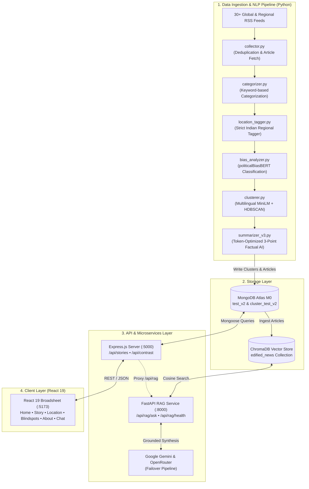
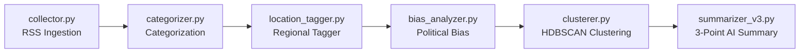
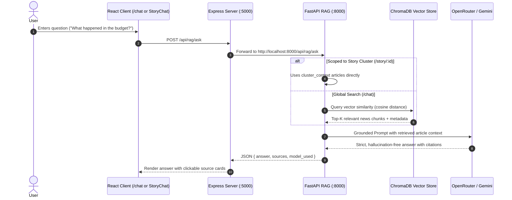

# The Edified — Architecture & Developer Master Guide

> *"True journalism is printing what someone else does not want printed; everything else is public relations."* — George Orwell

**The Edified** is an editorial news aggregation, multi-perspective contrast, and conversational intelligence platform. It ingests thousands of articles from 30+ regional, national, and global news outlets, semantically clusters them into cohesive event dossiers, synthesizes objective 3-point factual breakdowns, scores political bias, surfaces underreported "blindspot" stories, and provides a grounded, zero-hallucination Retrieval-Augmented Generation (RAG) conversational assistant.


---

## Table of Contents

1. [High-Level System Architecture](#1-high-level-system-architecture)
2. [Complete Directory & File Breakdown](#2-complete-directory--file-breakdown)
3. [Scraper & NLP Ingestion Pipeline (`scraperv2/`)](#3-scraper--nlp-ingestion-pipeline-scraperv2)
4. [RAG Microservice & Conversational AI (`rag/`)](#4-rag-microservice--conversational-ai-rag)
5. [Backend REST API (`server/`)](#5-backend-rest-api-server)
6. [Frontend Broadsheet Experience (`client/`)](#6-frontend-broadsheet-experience-client)
7. [Database Schemas (MongoDB Atlas & ChromaDB)](#7-database-schemas-mongodb-atlas--chromadb)
8. [Local Development & Setup Guide](#8-local-development--setup-guide)
9. [Maintenance, Database Cleanups & Operational Scripts](#9-maintenance-database-cleanups--operational-scripts)
10. [100% Free Cloud Deployment Plan](#10-100-free-cloud-deployment-plan)

---

## 1. High-Level System Architecture

The Edified operates across four distinct, loosely coupled layers sharing a single cloud MongoDB Atlas instance and local vector store:



---

## 2. Complete Directory & File Breakdown

```
Edified/
├── client/                      # React 19 + Vite frontend
│   ├── public/                  # Static assets & favicon
│   ├── src/
│   │   ├── api/
│   │   │   └── stories.js       # Axios/fetch helpers for Express and RAG endpoints
│   │   ├── components/
│   │   │   ├── layout/
│   │   │   │   ├── Navbar.jsx   # Top masthead, primary links, date, category tabs
│   │   │   │   └── Footer.jsx   # Broadsheet editorial footer
│   │   │   ├── rag/
│   │   │   │   ├── ChatCore.jsx # Shared chat components (ChatMessage, ChatInput, useChat hook)
│   │   │   │   └── StoryChat.jsx# Cluster-scoped drawer chatbot (visible only on /story/:id)
│   │   │   └── story/
│   │   │       ├── articleItem.jsx    # Article source item with author, outlet, bias label
│   │   │       ├── biasLabel.jsx      # Political spectrum badges (Left, Center, Right)
│   │   │       ├── categoryFilter.jsx # Horizontal category pill selector
│   │   │       ├── contrastView.jsx   # Multi-perspective side-by-side contrast component
│   │   │       ├── locationFilter.jsx # State & regional selector buttons
│   │   │       ├── sortMenu.jsx       # Sort toggle (Balanced, Coverage, Recency)
│   │   │       └── storyCard.jsx      # Homepage news card with image, excerpt, and source badges
│   │   ├── hooks/
│   │   │   ├── useContrast.js   # Fetches full cluster details for /story/:id
│   │   │   └── useStories.js    # Paginated hook fetching stories with category/location/sort filters
│   │   ├── pages/
│   │   │   ├── aboutUs.jsx      # Manifesto, interactive "Ask AI" search bar, feature showcase, team
│   │   │   ├── blindspots.jsx   # Dedicated section for singleton underreported stories
│   │   │   ├── chatPage.jsx     # Full-page standalone AI assistant (/chat) with URL query support
│   │   │   ├── home.jsx         # Front page: hero story, daily ledger, blindspots sidebar
│   │   │   ├── location.jsx     # Regional Indian coverage (Delhi, Maharashtra, UP, etc.)
│   │   │   └── storyDetail.jsx  # Wide asymmetrical cluster page (image, 3 points, all sources)
│   │   ├── App.jsx              # React Router v7 route definitions
│   │   ├── index.css            # Broadsheet typography, variables, design tokens
│   │   └── main.jsx             # React DOM entry point
│   ├── package.json             # React, Vite, Tailwind CSS, Lucide dependencies
│   └── vite.config.js           # Vite configuration & server proxy setup
│
├── server/                      # Node.js + Express.js backend
│   ├── config/
│   │   └── db.js                # Mongoose connection to MongoDB Atlas
│   ├── controllers/
│   │   ├── storiesController.js # Paginated stories, location filtering, search, aggregation ranking
│   │   └── contrastController.js# Cluster shaping, perspective contrasts, source categorization
│   ├── middleware/
│   │   ├── auth.js              # Optional JWT authorization middleware
│   │   └── errorHandler.js      # Global 404 & 500 error-handling handlers
│   ├── models/
│   │   ├── article.js           # Mongoose model for raw articles in test_v2
│   │   └── story.js             # Mongoose model for clusters in cluster_test_v2
│   ├── routes/
│   │   ├── stories.js           # Routes for /api/stories
│   │   ├── contrast.js          # Routes for /api/contrast
│   │   └── rag.js               # Proxy routes forwarding /api/rag to Python FastAPI
│   ├── clean_old_news.js        # Script: purges articles & clusters before specified date
│   ├── clean_world_locations.js # Script: clears stray location tags from world news
│   ├── normalize_dates.js       # Script: normalizes messy RSS pubDates into ISO Date objects
│   ├── server.js                # Main Express server entry point (Port 5000)
│   └── package.json             # Express, Mongoose, Axios, Cors dependencies
│
├── scraperv2/                   # Python Ingestion & NLP Pipeline
│   ├── bias_analyzer.py         # HuggingFace politicalBiasBERT classification
│   ├── categorizer.py           # Bilingual keyword rule-based categorizer
│   ├── clean_old_news.py        # Python date cleanup script
│   ├── cleanup_clusters.py      # Cleans empty or malformed cluster records
│   ├── clusterer.py             # Multilingual SentenceTransformer + HDBSCAN clustering engine
│   ├── collector.py             # RSS feed fetcher with URL/title hashing and deduplication
│   ├── config.py                # Pipeline database URIs, API keys, and constants
│   ├── location_tagger.py       # Strict title-based Indian state tagger (excludes world news)
│   ├── orchestrator.py          # Runs the entire scraping-to-clustering pipeline sequentially
│   ├── summarizer_v3.py         # Token-optimized 3-point factual summarizer (Gemini + OpenRouter)
│   └── summarizer_checkpoint.json # Progress tracking to prevent re-summarizing completed clusters
│
├── rag/                         # Python FastAPI Retrieval-Augmented Generation Microservice
│   ├── api.py                   # FastAPI server endpoints (/api/rag/ask, /api/rag/health)
│   ├── chunker.py               # Text chunking logic with character overlap and metadata preservation
│   ├── config.py                # RAG configuration, paths, ChromaDB settings, model names
│   ├── embedder.py              # SentenceTransformer embedding model wrapper
│   ├── generator.py             # LLM prompt builder & grounded answer generator (OpenRouter / Gemini)
│   ├── ingest.py                # Ingestion worker: reads MongoDB clusters & writes to ChromaDB
│   ├── rag_chain.py             # High-level RAG orchestrator linking retriever + generator
│   ├── retriever.py             # ChromaDB vector search with cosine distance filtering & cluster scoping
│   ├── requirements.txt         # FastAPI, ChromaDB, SentenceTransformers, Uvicorn, LangChain
│   └── chroma_store/            # Local ChromaDB persistent vector database directory
│
├── FREE_DEPLOYMENT_GUIDE.md     # Step-by-step guide to deploy all components 100% free
├── start_rag.bat                # Windows launcher batch script for the RAG microservice
└── README.md                    # This master documentation file
```

---

## 3. Scraper & NLP Ingestion Pipeline (`scraperv2/`)

The ingestion pipeline converts raw, fragmented RSS feeds into clean, verified story clusters:



### 1. Collector (`collector.py`)
- Reads active RSS sources from MongoDB collection `sources`.
- Normalizes feeds across diverse formats (RSS 2.0, Atom, Google News XML).
- Extracts title, link, summary/snippet, pubDate, and author.
- Generates an MD5 fingerprint of `title + url` to prevent duplicate insertions into `test_v2`.

### 2. Categorizer (`categorizer.py`)
- Analyzes article headlines against bilingual (English + Hindi) weighted keyword taxonomies.
- Assigns canonical categories: `Politics`, `World`, `Business`, `Technology`, `Science`, `Health`, `Sports`, or defaults to `General`.

### 3. Location Tagger (`location_tagger.py`)
- Scans article titles using strict regex word boundaries for Indian states:
  - *Delhi, Uttar Pradesh, Uttarakhand, Manipur, Maharashtra, West Bengal, Kerala, Punjab*.
- **World News Isolation Rule**: If `category == "world"`, regional location tags are set to `[]` (`locs = []`), guaranteeing foreign events (e.g., international summits mentioning Delhi or Washington) never contaminate domestic regional feeds.
- If domestic, it appends `"All India"`.

### 4. Bias Analyzer (`bias_analyzer.py`)
- Uses `bucketresearch/politicalBiasBERT` via HuggingFace Transformers.
- Classifies each article into: `Left`, `Center-Left`, `Center`, `Center-Right`, or `Right`.
- Computes a cluster-wide `biasDistribution` map:
  ```json
  { "left": 2, "centerLeft": 1, "center": 5, "centerRight": 2, "right": 0 }
  ```

### 5. Clusterer (`clusterer.py`)
- **Model**: `sentence-transformers/paraphrase-multilingual-MiniLM-L12-v2`.
- Embeds article headlines into 384-dimensional dense vectors.
- Uses **HDBSCAN** (`metric='cosine'`, `min_cluster_size=2`, `min_samples=1`) to identify dense clusters of articles covering the same breaking news event.
- **Singleton Handling**: Articles that do not cluster (HDBSCAN label `-1`) become 1-article singleton clusters, tagged as **Blindspots** (underreported news).
- Generates a cluster fingerprint: MD5 hash of sorted article IDs to prevent duplicate cluster creations upon re-runs.
- Upserts clusters into MongoDB collection `cluster_test_v2`.

### 6. Summarizer V3 (`summarizer_v3.py`)
- **Token-Optimized Multi-Source Strategy**: Focuses exclusively on top multi-source clusters (`articleCount >= 2`, sorted by coverage and recency, default `--top 100`). Single-article blindspots are preserved in their original form.
- **Prompt Structure**: Generates **EXACTLY 3 condensed points** (35–65 words each, half the size of narrative walls of text):
  1. `POINT 1 — Mainstream Narrative`: Central event and consensus reporting.
  2. `POINT 2 — Alternative Perspectives & Diverging Narratives`: Dissenting viewpoints, secondary angles, or criticisms.
  3. `POINT 3 — Verified Hard Facts`: Confirmed dates, statistics, numbers, and decisions.
  - Strict rule: Cites article sources at the end of each point: `(Articles: 1, 3, 5)`.
- **Failover Architecture**:
  - Primary: Google Gemini (`gemini-3.8-flash`, `gemini-3.5-flash-lite`, `gemini-2.5-flash`).
  - Fallback: OpenRouter (`openrouter/free`, `meta-llama/llama-3.3-70b-instruct:free`).
- **Flags**:
  - `python summarizer_v3.py --top 100` (summarizes top 100 clusters).
  - `python summarizer_v3.py --top 20 --force` (re-summarizes 20 clusters into the condensed length).
  - `python summarizer_v3.py --all` (processes all clusters without limit).

---

## 4. RAG Microservice & Conversational AI (`rag/`)

The RAG service operates as an independent FastAPI microservice on port **8000**, using a persistent local ChromaDB vector store:



### Key RAG Components:
- **`embedder.py`**: Loads `paraphrase-multilingual-MiniLM-L12-v2` via PyTorch CPU/GPU.
- **`chunker.py`**: Splits articles into overlapping character windows (`CHUNK_SIZE = 600`, `CHUNK_OVERLAP = 120`) preserving metadata (headline, source, URL, category, cluster ID).
- **`retriever.py`**: Queries ChromaDB collection `edified_news` using cosine similarity. Supports cluster-specific scoping via metadata filters.
- **`generator.py`**: Builds the system prompt instructing the model to rely **strictly** on supplied articles, never speculate, and cite sources. Uses OpenRouter free models with Gemini Flash failover.
- **`StoryChat.jsx`**: Floating drawer component rendered **only** on `/story/:id` pages. Sends `cluster_id` and `cluster_context`, allowing users to interrogate that specific event cluster.
- **`chatPage.jsx`**: Dedicated full-page route (`/chat`) linked in the navbar ("Ask AI"). Automatically reads URL query params (e.g., `/chat?q=What+happened+today`) to instantly run inquiries.

---

## 5. Backend REST API (`server/`)

Built with Node.js, Express, and Mongoose on port **5000**.

### API Endpoints:

| Method | Endpoint | Description | Query Parameters |
| :--- | :--- | :--- | :--- |
| `GET` | `/api/stories` | Paginated story clusters | `page`, `limit`, `category`, `location`, `maxArticles`, `sort` (`top`, `recent`, default balanced) |
| `GET` | `/api/stories/:id` | Raw cluster document by ID | None |
| `GET` | `/api/contrast/:storyId` | Formatted cluster for perspective contrast | None |
| `POST` | `/api/rag/ask` | Proxy to RAG FastAPI service | `{ question, category, top_k, cluster_id, cluster_context }` |
| `GET` | `/api/rag/health` | RAG service health & chunk stats | None |

### Balanced Ranking Algorithm:
In `storiesController.js`, stories on the front page are ranked using a composite score balancing **Coverage** (article count) and **Recency** (latest published date):
```javascript
newsScore = toLong(parsedDate) + (articleCount * 21,600,000 ms); // 6 hours boost per article
```
This ensures major multi-source developing stories get prime placement without pushing recent breaking news off the top.

---

## 6. Frontend Broadsheet Experience (`client/`)

Built with React 19, Vite, and Tailwind CSS. The design system mimics traditional broadsheet newspapers (Financial Times, The Guardian) blended with modern interactive typography.

### Pages & Routes:

1. **`Home` (`/`)**:
   - Editorial masthead with live date.
   - Lead story feature + 3-column daily ledger.
   - Category filtering bar (General, World, Politics, Business, Sports, Science, Health, Technology).
   - "The Blindspots" right rail showcasing singleton underreported news.
2. **`StoryDetail` (`/story/:id`)**:
   - Asymmetrical broadsheet grid (`minmax(320px, 460px) 1fr`, `maxWidth: 1440px`).
   - High-resolution hero image + 3-Point Factual Breakdown (*Mainstream Narrative*, *Alternative Perspectives*, *Verified Hard Facts*).
   - Complete list of source articles with political bias indicators (`ArticleItem.jsx`).
   - Contextual RAG Chat drawer button (`StoryChat.jsx`).
3. **`Location` (`/location`)**:
   - Regional sidebar: *All India, Delhi, Uttar Pradesh, Uttarakhand, Manipur, Maharashtra, West Bengal, Kerala, Punjab*.
   - Strict world news exclusion guarantees pure state-level reporting.
4. **`Blindspots` (`/blindspots`)**:
   - Filter-bubble breaker dedicated to high-impact stories covered by only 1–2 independent outlets.
5. **`AboutUs` (`/about`)**:
   - Positioned **first** in the primary navigation masthead.
   - Manifesto & Editorial Charter quote: *"No fluff. No clickbait. Just the weight of the word."*
   - **Interactive "Ask AI About the News" Search Bar**: Direct input box + suggestion pills redirecting to `/chat?q=...`.
   - Architectural feature showcase detailing Multi-Source Clustering, Perspective Contrast, 3-Point Summaries, and RAG.
   - Contributors section placed at the very end.
6. **`ChatPage` (`/chat`)**:
   - Full-page conversational news assistant.
   - Pre-populated prompt suggestions and source citation cards.

---

## 7. Database Schemas (MongoDB Atlas & ChromaDB)

### MongoDB: `cluster_test_v2` (Story Clusters)
```json
{
  "_id": "ObjectId",
  "headline": "FAA ground stop disrupts nationwide flight travel",
  "generatedHeadline": "FAA ground stop disrupts NBA and college sports travel",
  "category": "Sports",
  "locations": ["All India"],
  "tags": ["Aviation", "Sports"],
  "articleCount": 26,
  "coverSource": "Amar Ujala",
  "imageUrl": "https://images.example.com/airport.jpg",
  "summary": [
    "A severe telecommunications outage forced the FAA to halt ground operations across 22 regional centres for four hours... (Articles: 1, 3)",
    "Aviation analysts highlighted critical delays while airline representatives warned of multi-day rolling cancellations... (Articles: 2, 4)",
    "Over 11,000 flights and 1.5 million passengers were impacted by Friday evening with 700 advance weekend cancellations... (Articles: 1, 5)"
  ],
  "summaryModel": "gemini",
  "biasDistribution": {
    "left": 4,
    "centerLeft": 2,
    "center": 14,
    "centerRight": 4,
    "right": 2
  },
  "articles": [
    {
      "title": "US flight ground stop impacts weekend sports travel",
      "url": "https://example.com/story1",
      "real_url": "https://example.com/story1",
      "source_name": "Times of India",
      "publishedAt": "2026-11-13T14:00:00.000Z",
      "snippet": "Article lead paragraph...",
      "biasLabel": "center",
      "biasScore": 0.04
    }
  ],
  "latestPublishedAt": "2026-11-13T15:30:00.000Z",
  "clusterFingerprint": "d41d8cd98f00b204e9800998ecf8427e",
  "isActive": true,
  "createdAt": "2026-11-13T15:00:00.000Z",
  "updatedAt": "2026-11-14T12:00:00.000Z"
}
```

### ChromaDB: `edified_news` (Vector Store)
- **ID**: `hash(cluster_id + chunk_index)`
- **Embedding**: 384-dimensional dense vector (`paraphrase-multilingual-MiniLM-L12-v2`)
- **Document Text**: Chunked text window (600 characters)
- **Metadata**:
  - `headline`: Cluster headline
  - `source`: Primary outlet name
  - `url`: Direct article link
  - `category`: Cluster category
  - `cluster_id`: Associated MongoDB `_id`

---

## 8. Local Development & Setup Guide

### Prerequisites:
- **Node.js** v18+ & **npm**
- **Python** 3.10+ (with `pip` and PyTorch)
- **MongoDB Atlas** account (or local MongoDB running on 27017)
- API Keys: **Google AI Studio** (`GEMINI_API_KEY`) and **OpenRouter** (`OPENROUTER_API_KEY`)

### Step 1: Environment Variables Setup

Create `scraperv2/.env`:
```env
MONGO_URI=mongodb+srv://<username>:<password>@cluster0.mongodb.net/news_aggregator?retryWrites=true&w=majority
DB_NAME=news_aggregator
COL_RAW_ARTICLES=test_v2
COL_CLUSTERS=cluster_test_v2

OPENROUTER_API_KEY=your_openrouter_api_key_here
GEMINI_API_KEY=your_gemini_api_key_here

OPENROUTER_MODEL=openrouter/free
GEMINI_MODEL=gemini-3.8-flash
```

Create `server/.env`:
```env
PORT=5000
MONGO_URI=mongodb+srv://<username>:<password>@cluster0.mongodb.net/news_aggregator?retryWrites=true&w=majority
RAG_API_URL=http://localhost:8000/api/rag
```

### Step 2: Install Dependencies

```powershell
# 1. Install Server Dependencies
cd server
npm install

# 2. Install Client Dependencies
cd ../client
npm install

# 3. Install Python Dependencies (Scraper & RAG)
cd ..
pip install -r rag/requirements.txt
pip install beautifulsoup4 langdetect scikit-learn numpy pymongo requests python-dotenv
```

### Step 3: Run the Services

Open **three separate terminal windows**:

**Terminal 1 — Backend API (Port 5000)**:
```powershell
cd server
node server.js
```

**Terminal 2 — RAG Microservice (Port 8000)**:
```powershell
# Either run the batch file:
.\start_rag.bat
# Or manually:
python -m uvicorn rag.api:app --host 0.0.0.0 --port 8000 --reload
```

**Terminal 3 — Frontend Dev Server (Port 5173)**:
```powershell
cd client
npm run dev
```

Visit **`http://localhost:5173`** in your browser.

---

## 9. Maintenance, Database Cleanups & Operational Scripts

### 1. Run Scraper Pipeline:
```powershell
cd scraperv2
python collector.py        # Fetch RSS feeds
python categorizer.py      # Categorize articles
python location_tagger.py  # Tag Indian states (excludes world news)
python clusterer.py        # Group stories via HDBSCAN
python summarizer_v3.py --top 100  # Summarize top 100 clusters
```

### 2. Ingest Articles into RAG Vector Store:
```powershell
python -m rag.ingest
```

### 3. Clear World News from Regional Locations:
If any world news cluster contains accidental regional tags:
```powershell
cd server
node clean_world_locations.js
```

### 4. Purge Outdated News:
To keep MongoDB Atlas storage within the free 512 MB limit:
```powershell
cd server
node clean_old_news.js
```

---

## 10. 100% Free Cloud Deployment Plan

To host the entire platform permanently for **$0/month**, use this specialized distribution:

| Component | Platform | Free Specs | Why? |
| :--- | :--- | :--- | :--- |
| **Frontend** | **Vercel** / **Cloudflare Pages** | 100 GB/mo bandwidth, Edge CDN | Instant git deploys, zero cold starts, free SSL. |
| **Express Backend** | **Render** or **Koyeb** | 750 free hours/month | Native Node environment, automatic HTTPS. |
| **MongoDB Database** | **MongoDB Atlas M0 Sandbox** | 512 MB storage (Permanent) | Free forever; manages raw news, clusters, and users. |
| **RAG Microservice** | **Hugging Face Spaces** *(Docker)* | **16 GB RAM + 2 vCPUs Free Forever** | PyTorch and embeddings need ~1.2 GB RAM (crashes on 512 MB free tiers). |
| **Scraper Automation** | **GitHub Actions** (Cron schedule) | 2,000 free runner minutes/month | Runs collector, clusterer, and summarizer every 6 hours automatically. |
| **LLMs** | **Google AI Studio + OpenRouter** | Free rate limits | Gemini Flash + OpenRouter free tier models. |

*For complete step-by-step instructions and configuration files, see [FREE_DEPLOYMENT_GUIDE.md](file:///d:/FSD_Edified_project/RSS%20FEED/NEWS_PRO/Edified/FREE_DEPLOYMENT_GUIDE.md).*
